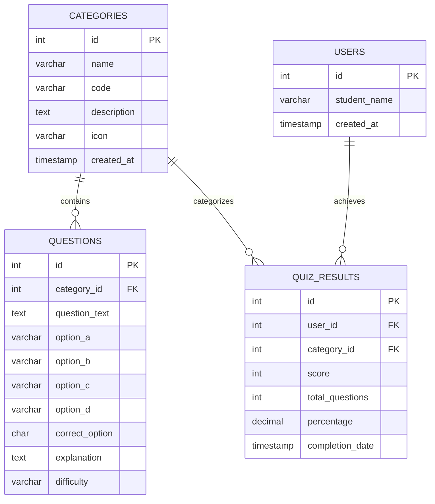

# Smart Quiz &mdash; 11th Standard School Project

> **"Learn, Play and Test Your Knowledge"**  
> A simple, modern, and fully responsive Quiz Web Application designed for high school computer science curriculum evaluation.

---

## 📋 Table of Contents
1. [Project Overview](#-project-overview)
2. [Technology Stack](#-technology-stack)
3. [Key Features](#-key-features)
4. [DBMS Concepts & Database Schema](#-dbms-concepts--database-schema)
5. [How Java, Python, MySQL, and DBMS are Used](#-how-java-python-mysql-and-dbms-are-used)
6. [Folder Structure](#-folder-structure)
7. [Step-by-Step Setup Guide on Windows](#-step-by-step-setup-guide-on-windows)
8. [Configuring MySQL Credentials](#-configuring-mysql-credentials)
9. [Running the Application](#-running-the-application)
10. [Automated Testing & Verification](#-automated-testing--verification)
11. [Sample Viva Questions & Answers](#-sample-viva-questions--answers)

---

## 🎯 Project Overview
**Smart Quiz** is an interactive web platform developed for 11th-grade students to test their understanding across core computer science and general knowledge disciplines:
- **Java Programming** (Object-Oriented Programming, syntax, loops, and types)
- **Python Programming** (Data types, functions, control flow, and lists)
- **MySQL** (Relational queries, clauses, aggregate functions, and constraints)
- **DBMS** (Relational theory, keys, normalization, and ACID properties)
- **History** (Indian freedom movement, ancient civilizations, and world milestones)
- **Science** (Physics fundamentals, chemistry, biology, space, and discoveries)

The application enforces **secure server-side scoring**, meaning correct answers and explanations are never sent to the student's browser until after submission.

---

## 🛠️ Technology Stack

| Layer | Technology | Purpose |
|---|---|---|
| **Frontend UI** | HTML5, Vanilla CSS3, JavaScript (ES6+) | Modern, responsive interface with a blue-purple palette, mobile-friendly layout, and zero heavy dependencies. |
| **Backend** | Python (Flask) | Lightweight web server, route handling, session management, and server-side score calculation. |
| **Database** | MySQL (with SQLite Fallback) | Relational database (`smart_quiz`) storing categories, questions, users, and results. Includes automatic fallback to SQLite for evaluation flexibility. |
| **Database Driver** | PyMySQL / `sqlite3` | Pure Python DB-API compliant driver for parameterized SQL execution. |

---

## ✨ Key Features

1. **Category Selection:** 6 distinct subject cards showing available question counts and icons.
2. **Simple Registration:** Asks for student's name before starting a quiz (no passwords, emails, or phone numbers needed).
3. **Randomized 10-Question Tests:** Each attempt selects 10 random questions from the database bank of 132+ questions.
4. **Interactive Quiz Interface:**
   - 4 multiple-choice options per question with single selection.
   - Question Counter (e.g., *Question 3 of 10*) and animated Progress Bar.
   - Question Palette (bubbles 1 to 10) showing answered, unanswered, and current question.
   - Next and Previous navigation with option to review and change choices.
5. **Pre-Submission Confirmation:** Summarizes answered vs. unanswered questions before submitting.
6. **Comprehensive Results & Explanations:**
   - Score circle (e.g., 9 out of 10), percentage, and performance-based encouragement badge.
   - Breakdown of correct and incorrect answers.
   - **Review Answers:** Highlights the student's selection, marks correct answers in green, and provides educational explanations for every question.
7. **Leaderboard & Quiz History:** Logs student attempts, scores, and timestamps in the database, with a live search filter.

---

## 🗄️ DBMS Concepts & Database Schema

The database `smart_quiz` is built with four normalized relational tables:



### 1. Primary & Foreign Keys
- **Primary Keys:** `categories(id)`, `questions(id)`, `users(id)`, `quiz_results(id)` uniquely identify each record.
- **Foreign Keys:**
  - `questions.category_id` references `categories.id` (`ON DELETE CASCADE`)
  - `quiz_results.user_id` references `users.id` (`ON DELETE CASCADE`)
  - `quiz_results.category_id` references `categories.id` (`ON DELETE CASCADE`)

### 2. Normalization
- **1NF:** Every column contains atomic values; no repeating groups.
- **2NF:** All non-key attributes are fully dependent on their table's primary key.
- **3NF:** No transitive dependencies. Student names live in `users`, preventing redundant duplication in `quiz_results`.

### 3. Parameterized SQL Queries Used
All queries use placeholder tuples (`%s` in MySQL, converted automatically to `?` in SQLite) to eliminate SQL injection:
```sql
-- Selecting 10 random questions:
SELECT id, category_id, question_text, option_a, option_b, option_c, option_d
FROM questions
WHERE category_id = %s
ORDER BY RAND()
LIMIT 10;

-- Inserting student attempt:
INSERT INTO quiz_results (user_id, category_id, score, total_questions, percentage)
VALUES (%s, %s, %s, %s, %s);

-- Displaying recent history:
SELECT r.id, r.score, r.total_questions, r.percentage, r.completion_date,
       u.student_name, c.name AS category_name
FROM quiz_results r
JOIN users u ON r.user_id = u.id
JOIN categories c ON r.category_id = c.id
ORDER BY r.completion_date DESC
LIMIT 30;
```

---

## 💡 How Java, Python, MySQL, and DBMS are Used

| Discipline | Role in Project | Educational Value |
|---|---|---|
| **Python** | Flask web backend (`app.py`, `database.py`) | Demonstrates backend web development, server routing, sessions, and data processing. |
| **MySQL** | Relational Database Engine (`schema.sql`, `seed_data.py`) | Demonstrates table creation, foreign key constraints, indexing, and transactional integrity. |
| **DBMS Concepts** | Schema architecture & Normalization | Teaches ER relationships (1:N), primary keys, referential integrity, and SQL querying. |
| **Java** | Dedicated Quiz Category (22+ Questions) | Allows high school students to practice Java OOP concepts (classes, objects, methods, types, loops) without complicating web server deployment. |

---

## 📁 Folder Structure

```
smart_quiz/
├── app.py                 # Main Flask web application and routes
├── database.py            # Database manager (MySQL connection & SQLite fallback)
├── schema.sql             # SQL script creating database, tables, and constraints
├── seed_data.py           # 132+ Questions across all 6 categories
├── sample_records.py      # Sample student results generator for demo
├── test_app.py            # Automated test suite
├── requirements.txt       # Python package dependencies
├── smart_quiz.db          # Ready-to-use database file
├── README.md              # Project documentation and setup guide
├── static/
│   ├── css/
│   │   └── style.css      # Custom responsive CSS with blue-purple theme
│   └── js/
│       ├── main.js        # Home page modal, local storage, history search
│       └── quiz.js        # Question slides, navigation, and submission modal
└── templates/
    ├── base.html          # Base layout with header, nav, and footer
    ├── index.html         # Home page with 6 categories and stats
    ├── quiz.html          # Quiz interface with 10 questions and progress bar
    ├── result.html        # Score card, review answers, and explanations
    ├── history.html       # Student history and leaderboard table
    ├── about.html         # DBMS and architecture viva documentation
    ├── 404.html           # Page not found error page
    └── 500.html           # Internal server error page
```

---

## 🚀 Step-by-Step Setup Guide on Windows

### Step 1: Install Python (if not already installed)
1. Download Python 3.10+ from [python.org](https://www.python.org/downloads/).
2. During installation, make sure to check **"Add Python to PATH"**.

### Step 2: Open Command Prompt or PowerShell
Navigate to the project directory:
```powershell
cd "d:\Smart Quiz"
```

### Step 3: Install Required Python Packages
```powershell
pip install -r requirements.txt
```
*Packages installed: `Flask`, `PyMySQL`, `cryptography`, `python-dotenv`.*

---

## ⚙️ Configuring MySQL Credentials

By default, the project will automatically connect to a local MySQL server if available. If MySQL is not running or not yet configured, the system **automatically and seamlessly falls back to the embedded SQLite database**, allowing immediate presentation without errors!

### To Connect to your MySQL Server (e.g., MySQL Workbench or XAMPP):
1. Ensure your MySQL service is started (via XAMPP Control Panel or Windows Services).
2. Set your credentials as environment variables or edit the top of `database.py`:
   ```powershell
   $env:DB_HOST="localhost"
   $env:DB_PORT="3306"
   $env:DB_USER="root"
   $env:DB_PASSWORD="your_mysql_password"
   $env:DB_NAME="smart_quiz"
   ```
3. Import the schema and seed data into MySQL:
   ```powershell
   mysql -u root -p < schema.sql
   python seed_data.py
   ```

---

## 🖥️ Running the Application

To start the Flask development server:
```powershell
python app.py
```

### 📱 Accessing on Desktop and Android Devices

The server binds to `0.0.0.0` to allow access from both your computer and any mobile phone on the same Wi-Fi network:

- **Desktop / Laptop Browser:**
  ```text
  http://127.0.0.1:5000/
  ```

- **Android Phone / Tablet (or iPhone/iPad):**
  Connect your Android device to the same Wi-Fi network as your computer, open Chrome or your preferred browser, and go to:
  ```text
  http://<your-computer-ip>:5000/
  ```
  *(The exact URL, e.g., `http://192.168.0.106:5000`, is displayed automatically in the terminal when you start `app.py`)*

### 📱 Mobile & Android Responsive Optimizations
- **Mobile Hamburger Navigation:** Clean animated 3-bar toggle with slide-down menu and backdrop dismiss.
- **Touch-Friendly Tap Targets:** Buttons and multiple-choice options have generous min-heights (48px+) and active touch feedback.
- **Smart Viewport & Zoom Protection:** Optimized meta tags and form fields prevent unwanted automatic zooming on Android Chrome.
- **Adaptive Quiz Layout:** 1-column responsive card layouts, compact progress indicators, and horizontally scrollable scoreboards.

---

## 🧪 Automated Testing & Verification

Run the included automated test suite to verify all endpoints, database operations, and quiz scoring:
```powershell
python test_app.py
```
Expected output:
```
Ran 6 tests in 0.476s
OK
```

---

## ☁️ Cloud & Public Deployment Guide

### ⚡ Option 1: Instant Free Public Link (Live Right Now!)
You can generate a live public HTTPS link instantly with zero setup or accounts required:
- Simply double-click **`start_public_share.bat`** (or run `.\cloudflared.exe tunnel --url http://127.0.0.1:5000`).
- It generates a secure public link like: `https://<unique-name>.trycloudflare.com`
- Anyone in the world on any Android phone, iPhone, tablet, or PC can immediately access your quiz through this link!

---

### 🌐 Option 2: Deploy to Render.com (Permanent 24/7 Cloud Hosting)
1. Push this project folder to your GitHub account (or create a new GitHub repository called `smart-quiz` and upload files).
2. Visit [render.com](https://render.com) and sign in with GitHub.
3. Click **"New +"** $\rightarrow$ **"Web Service"**.
4. Select your `smart-quiz` repository.
5. Fill in the basic settings:
   - **Environment:** `Python 3`
   - **Build Command:** `pip install -r requirements.txt`
   - **Start Command:** `gunicorn --bind 0.0.0.0:$PORT app:app`
   - **Instance Type:** `Free`
6. Click **Deploy Web Service**.
7. In ~2 minutes, your website is live worldwide with a free SSL/HTTPS URL like:
   `https://smart-quiz-xxxx.onrender.com`

---

### ▲ Option 3: Deploy to Vercel (Edge Serverless Hosting)
1. Push this project to GitHub (or upload via [github.com/new](https://github.com/new)).
2. Log into [vercel.com](https://vercel.com/) with GitHub.
3. Click **"Add New..."** $\rightarrow$ **"Project"** $\rightarrow$ **"Import"** next to `smart-quiz`.
4. Vercel automatically detects `vercel.json` and `api/index.py`. Click **Deploy**.
5. In ~45 seconds, your site is live with a permanent URL like:
   `https://smart-quiz-xxxx.vercel.app`

---

### 🐍 Option 4: Deploy to PythonAnywhere.com
1. Create a free account at [pythonanywhere.com](https://www.pythonanywhere.com).
2. Go to the **Web** tab and click **Add a new web app**.
3. Select **Manual Configuration** (or Flask) $\rightarrow$ **Python 3.10 / 3.11**.
4. In the **Code** section, set Source Code directory to `/home/yourusername/smart_quiz`.
5. In the **WSGI configuration file**, point to `wsgi.py`:
   ```python
   import sys
   path = '/home/yourusername/smart_quiz'
   if path not in sys.path:
       sys.path.append(path)
   from app import app as application
   ```
6. Click **Reload yourusername.pythonanywhere.com** to launch.

---

### 🚀 Option 5: Local / School Lab Production Server (Waitress)
To run a high-performance, multi-threaded production WSGI server on Windows (ideal for school science exhibitions or computer lab presentations):
```powershell
python run_production.py
```
This runs without the Flask development server warning and can handle simultaneous traffic from dozens of student laptops and Android phones on the school Wi-Fi.

---

## 🎓 Sample Viva Questions & Answers

1. **Q: Why is server-side score calculation important in a quiz website?**  
   *A:* If correct answers are sent to the client browser (in HTML or JavaScript), students can open Developer Tools (Inspect Element) and find the answers before submitting. By evaluating answers on the Flask server, the quiz remains secure and tamper-proof.

2. **Q: How does the application handle referential integrity?**  
   *A:* Foreign keys with `ON DELETE CASCADE` ensure that if a category or user is deleted, all dependent questions or quiz results are cleaned up automatically without leaving orphaned records.

3. **Q: Why use Python Flask instead of pure HTML/JS?**  
   *A:* Pure HTML/JS cannot securely query a MySQL database. Flask acts as the middle-tier controller that executes SQL queries, maintains user sessions, and dynamically renders Jinja2 templates.

4. **Q: What is the purpose of database normalization in this project?**  
   *A:* Normalization into 1NF, 2NF, and 3NF ensures that category names and student names are stored in their own tables rather than repeated in every question or quiz result row, preventing data redundancy and update anomalies.
